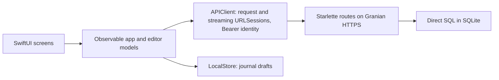

# Collaborator entry point

The app opens on Home and has a bottom bar with Journal, Pattern, Add dream (which opens the editor over the screen), Life notes and Settings, following the team's user-test prototype `DreamLog_User_Test.html` at the repo root (the header and bar in `Shell.swift`; colors, fonts and the shared card, field and button styles in `Theme.swift`). The interface is native SwiftUI; the API is plain authenticated JSON over HTTPS. The backend's task worker calls Gemini for the summary and tags (`organize`), the analysis (`analyze`) and pattern discovery (`index_dream`, `match_patterns`, `refresh_findings`).

## File map

| Feature | Screen and state | API / backend | Storage |
| --- | --- | --- | --- |
| Shell | `Shell.swift`: `Header` (the prototype's title bar, `.page(...)`), `BackButton`, `HomeButton` (⌂), `BottomBar`; `RootView` shows one screen above the bar | — | — |
| Home | `Home.swift`: `HomeView` (latest dream, the Garden of pattern findings, Type a dream; shown while `AppModel.showingHome`); `Bubbles.swift`: `BubbleCluster`, `ClusterLayout` | `/v1/dreams` (the journal's first page), `/v1/patterns` | — |
| Journal | `JournalView` (search and the `JournalFilterSheet`), `JournalModel` (with the queued-draft resend), `DreamEditor`, `DreamModel` | `/v1/dreams`, `/v1/dreams/search`, `dreams.py` (routes and the `organize` handler), `providers.py` (Gemini text adapter) | `dreams`, `outputs`, `tags`; unsent drafts in phone SQLite |
| Dream Detail | `DreamDetail.swift`: `DreamDetailView` (switches, summary and tags with corrections, analysis, context used, delete), `AnalysisModel` | `/v1/dreams/{id}/permissions`, `/corrections`, `/analysis` | as Journal and Analysis |
| Analysis | `AnalysisModel`, `Analysis` types in `AIModels.swift` | `/v1/dreams/{id}/analysis`, `/analysis/refresh`, `analysis.py` (context selection and the `analyze` handler) | `outputs` (type `analysis`), `sources` |
| Discussion | `Discussion.swift`: `DiscussionView` (the prototype's conversation screen, Start afresh, Remember in profile and Add to dream on each message the user wrote), `DiscussionModel`; types in `AIModels.swift` | `/v1/dreams/{id}/conversation`, `/messages` (server-sent events), `/restart`, `discussion.py` (prompt and final check), `streams.py` (`run_turn`, the offer line), `providers.stream_text` | `messages`, `conversations`, `sources` (`message_id`) |
| Patterns | `PatternsView` (finding cards; Garden is a `BubbleCluster` of the findings), `PatternDetailView` (rename, split, dismiss), `PatternsModel` | `/v1/patterns`, `/v1/patterns/groups/{id}/label`, `/dismiss`, `/split`, `patterns.py` (indexing, matching, findings), `providers.embed` | `dream_vectors`, `occurrences`, `pattern_*` tables (sqlite-vector) |
| Notes | `NotesView`, `NoteEditorView`, `NotesModel`, `NoteEditorModel` | `/v1/memories` (with `title`), `memories.py`, `photos.py` | `memories` (`title` since version 6), `memory_photos`; unsent editor state in memory |
| Profile | `ProfileSettings`, `ProfileModel` | `/v1/me/profile`, `profiles.py` | `profiles.fields_json` |
| Settings and deletion | `Settings` (the Settings tab), `AppModel` (tab, `newDream` for the Add dream tab, `refreshes` on foreground, reconnection or editor close) | `/v1/me`, `records.py` | `users`; delete cascades profiles, notes and journals |
| AI tasks | `TaskInfo` in `JournalModels.swift`, `failureText` (wiki 4.4.6 wording) in `AIModels.swift` | `/v1/tasks/{id}/retry`, `tasks.py` (worker), `records.py` (`charge`), `providers.py` | `tasks`, `usage` |
| Shared infrastructure | `Identity`, `APIClient`, `PrivacyNotice`, `LocalStore` | `main.py`, `web.py`, `db.py`, `config.py` | Device-only Keychain, database schema |

All Swift files above are in `ios/DreamLog/`; backend files are in `backend/`. Routes are listed in `backend/main.py`. Read [API.md](API.md) for callable contracts and [LocalDevelopment.md](LocalDevelopment.md) to run them.

## How to extend

- A normal profile field: add one `ProfileField` to `profileFields` in `ProfileSettings.swift`. Keys and values already round-trip through the dictionary API and SQLite JSON. Users can add or remove fields in Settings too. Add special backend validation in `profiles.py` only when the new field needs it; age already has a numeric rule. All values are strings.
- A new feature: put its route functions and SQL in one backend module, register routes in `main.py`, add the corresponding JSON value types/APIClient methods and a SwiftUI screen with an observable state model. Follow an existing feature rather than introducing a service/ORM/repository layer.
- New persistence: change `schema.sql`, increment `SCHEMA_VERSION` and add an explicit, tested upgrade path in `db.py`. Backend version 3 adds note photos to versions 1/2 without replacing data; version 4 adds the pattern tables, version 5 adds `dream_vectors` and version 6 adds the note `title` column, each preserving earlier versions the same way. The phone draft schema remains version 1.
- Privacy text: edit `privacyParts` and increase `noticeVersion` in `PrivacyNotice.swift`. First launch and Settings read the same six short parts. The user requested provisional, brief copy; this supersedes the wiki's full copy for this development build. The acknowledgment gate remains active.
- Cloud: configure the HTTPS origin, TLS and data directory. The mobile app continues calling the same API. Managed database/release differences belong in [ProductionTransition.md](ProductionTransition.md).

## Rules that collaborators should preserve

The Bearer UUID determines the owner. Never accept a request body owner as authorization. A note/journal ID owned by another user returns 404. Omitted update fields retain their stored values where the API documents a partial update. Revisions prevent stale content from overwriting a newer version. Repeated unchanged saves keep their IDs and revisions. Save failure keeps editor input; delete failure keeps visible records.

Settings profile edits use a separate endpoint so automatic timezone/history updates cannot erase personal fields. Profile data is not fed into AI. All requests use APIClient's privacy gate and shared cancelable session. Whole-journal deletion also deletes Notes and Profile.

## Scope boundary

This is the user's requested CRUD foundation, not a full Increment 5/AI pipeline. Notes follow the wiki's memory representation, ownership, dates and revisions; there is no worker, AI dependency invalidation, context selection or check-in behavior yet. Later AI collaborators must add those effects before scheduling AI tasks, including dependencies affected by note changes/deletion. Profile fields are an explicit addition to the wiki design.

Journal now commits automatically on leaving the editor and offers Revert instead of Save. Notes also supports photo attachments. [EditorAndPhotos.md](EditorAndPhotos.md) records the interaction rules, storage choice, callable photo API and explicit `AI integration point` comments in the code.

Story map v2 (revised 11 October 2026) places recurring patterns with rename, dismiss and split in its Skeletal tier, ahead of the wiki's Arc C stretch placement. Schema version 5 therefore already holds every wiki §4.8.2 table (`dream_vectors`, `occurrences`, `pattern_groups`, `pattern_memberships`, `pattern_corrections`, `pattern_separations`) and the `current_occurrences` view. `dream_vectors` is included because `index_dream`, the first pattern task, writes it together with `occurrences`. The contracts the remaining Skeletal cards need are in [SkeletalContracts.md](SkeletalContracts.md).

Short privacy copy is provisional development content. Detailed provider, recording and project-end policies must be restored before those features or a release. Voice and media remain future work; discussion has follow-up questions, Start afresh and the two actions on the user's messages, without the goal and correction routes. The backend is deployed on the course server at `https://34.66.84.214` ([ProductionTransition.md](ProductionTransition.md)); Debug builds talk to the developer's own backend, and only Release builds and ship checks that override `DREAMLOG_SERVER_URL` use the server ([LocalDevelopment.md](LocalDevelopment.md)). No App Store submission is claimed.
